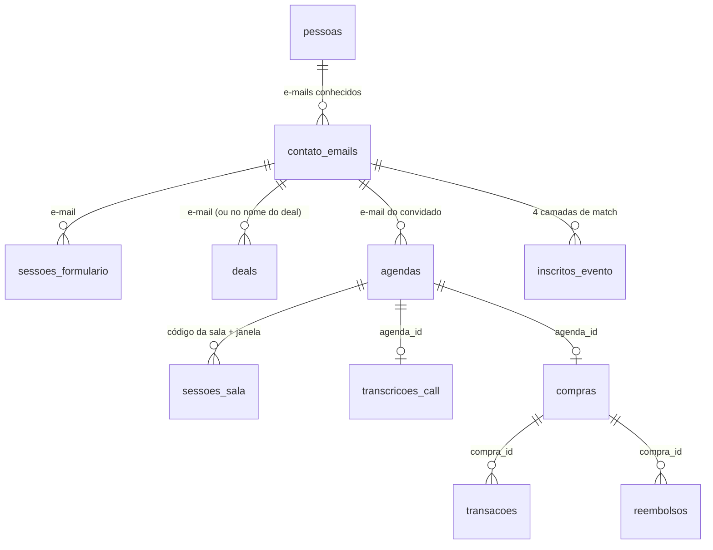

# Análises de RevOps: seis estudos de caso de operação comercial

Seis análises de uma operação comercial B2C (edtech de pós-graduação, com SDRs e closers). Cada uma parte de uma pergunta da diretoria, encontra a **armadilha** que faria a resposta sair errada e entrega número, gráfico e recomendação. Tudo é reproduzível em DuckDB sobre um dataset sintético.

O que demonstra: SQL analítico, escolha de grão e de chave de identidade, joins com janela de tempo, cuidado com mudança de registro e viés de preenchimento, e comunicação para quem decide.

## Os casos

| # | Estudo | A armadilha |
|---|---|---|
| 01 | [Churn é arrependimento da 1ª semana](analises/01-churn-primeira-semana/) | Taxa por transação e filtro do indicador oficial escondem 2/3 do churn |
| 02 | ["% de perda por dinheiro" mede quem registra](analises/02-objecao-dinheiro/) | 3 vendedores fazem 96% dos registros; o CRM dobra o peso da objeção |
| 03 | [Pontualidade das calls](analises/03-pontualidade-calls/) | Sala reutilizada: sem janela de tempo, o join gera atraso de 178 dias |
| 04 | [Revisão da definição de MQL](analises/04-revisao-mql/) | Deal, e-mail e pessoa dão três números; âncora errada deixa MQL > Lead |
| 05 | [Tiers de lead e previsibilidade](analises/05-tiers-previsibilidade/) | Run-rate só reage depois; o mix de tier avisou 5 semanas antes |
| 06 | [Lista de evento × agenda × venda](analises/06-lista-evento-x-funil/) | E-mail sozinho perde 25% dos inscritos; nome único acerta só 61% |

## Como rodar

Requer Python 3.11+.

```bash
python3 -m venv .venv
.venv/bin/pip install -r requirements.txt
.venv/bin/python run_all.py      # gera o dataset, roda as 6 análises, salva CSVs e gráficos
.venv/bin/pytest                 # 33 testes: invariantes do gerador + cada achado dos READMEs
```

O dataset completo é gerado em ~4 segundos, então não fica versionado (`dados/` está no `.gitignore`). Resultados (`analises/*/resultados/*.csv`) e gráficos ficam no repositório para leitura direta.

## Estrutura

```
gerador/gerar_dados.py        dataset sintético (seed 42), padrões plantados de propósito
analises/_base.sql            views comuns: identidade (e-mail → pessoa) e calls (join com janela)
analises/0N-<estudo>/         README do caso, consulta.sql, grafico.png, resultados/
revops.py                     conexão DuckDB, carga do Parquet, executor de consultas nomeadas
run_all.py                    pipeline completo + gráficos
tests/                        pytest
```



Cada `consulta.sql` é dividido em blocos `-- name: <consulta>`; cada bloco vira um CSV em `resultados/`. Blocos `-- name: _setup` só criam views auxiliares.

## Decisões

- **DuckDB + Parquet** em vez de um Postgres: as análises são de leitura, cabem em memória e rodam sem infraestrutura. Quem clonar roda tudo em segundos.
- **Gerador com padrões plantados e testes que os verificam:** cada afirmação dos READMEs tem um teste correspondente em `tests/test_analises.py`. Se alguém mudar uma consulta e o achado sumir, o teste quebra.
- **Gabarito do match de evento** gerado junto com os dados (`_gabarito_evento`). Foi ele que mostrou que a camada de nome tinha só 61% de precisão: sem gabarito, ela pareceria só "mais cobertura".

---

Dados 100% fictícios, gerados por [`gerador/gerar_dados.py`](gerador/gerar_dados.py). Projeto inspirado em trabalho real, reconstruído do zero sem código ou dados de empregador ou cliente. Nomes de pessoas são inventados.
