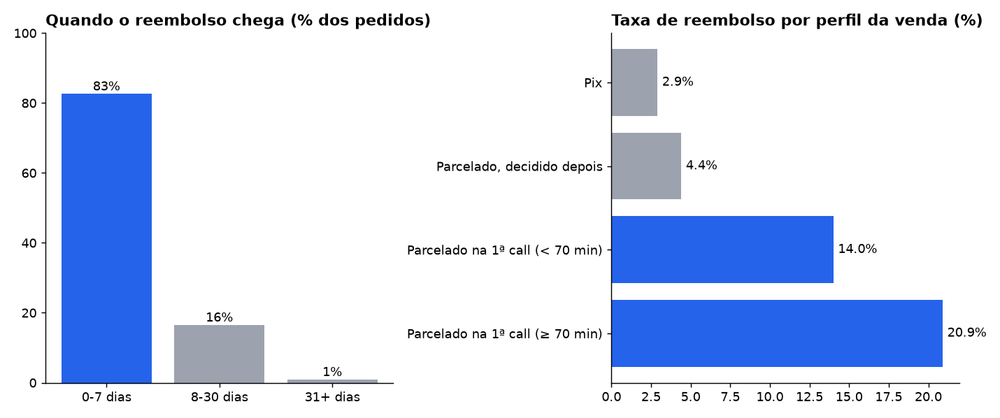

# 01 · Churn é arrependimento da primeira semana

**Pergunta:** qual é a taxa de churn por origem de venda, e onde ela se concentra?

**Armadilhas encontradas**
- **Grão errado.** Calculada por transação, a taxa do boleto parcelado cai de 12,2% para 3,2%: cada compra gera várias transações e o denominador incha.
- **Filtro do indicador oficial.** O "churn oficial" exclui estorno de 1ª parcela, retido e downsell. Em abr–mai, ele mostra 3,5% enquanto a taxa ampla é 9,5%: o indicador enxerga só um terço do problema.
- **Mudança de registro no meio da série.** O estorno de 1ª parcela só passa a ser registrado em abril. Comparar março com abril mede a mudança do processo, não a operação.
- **Coorte imatura.** Compras de junho ainda não tiveram janela completa de reembolso e ficam fora (só compras até 31/05).

## Método

1. Grão **compra** (uma linha por compra), não transação.
2. Tempo entre compra e pedido de reembolso, em faixas.
3. Perfil da venda: forma de pagamento × venda decidida no mesmo dia da 1ª call × duração da call. A duração vem do log da sala de reunião, com a janela de tempo do estudo 03.

## Resultado

| Quando o reembolso chega | % dos pedidos | acumulado |
|---|---:|---:|
| 0–7 dias | 82,6% | 82,6% |
| 8–30 dias | 16,5% | 99,1% |
| 31+ dias | 0,9% | 100% |

| Perfil da venda | Compras | Taxa de reembolso |
|---|---:|---:|
| Pix | 311 | 2,9% |
| Parcelado, decidido depois da call | 367 | 4,4% |
| Parcelado na 1ª call (< 70 min) | 358 | 14,0% |
| Parcelado na 1ª call (≥ 70 min) | 115 | **20,9%** |

Quase todo reembolso chega na primeira semana. Ele se concentra na venda parcelada fechada na própria call, e piora quando a call é longa. Mais do que desengajamento do cliente, é **venda que não deveria ter fechado naquele momento**.

## Recomendação

- Medir churn no grão compra, em janela de 30 dias, com a taxa ampla ao lado da oficial.
- Piloto de **confirmação no dia seguinte** para venda parcelada fechada na 1ª call: uma mensagem ou uma ligação curta antes de liberar o acesso. É mais barato que o reembolso e não trava a venda boa, como faria uma regra dura.
- Ao comparar períodos, separar o que é mudança de registro do que é mudança de comportamento.

Consultas: [`consulta.sql`](consulta.sql) · resultados em [`resultados/`](resultados/)
