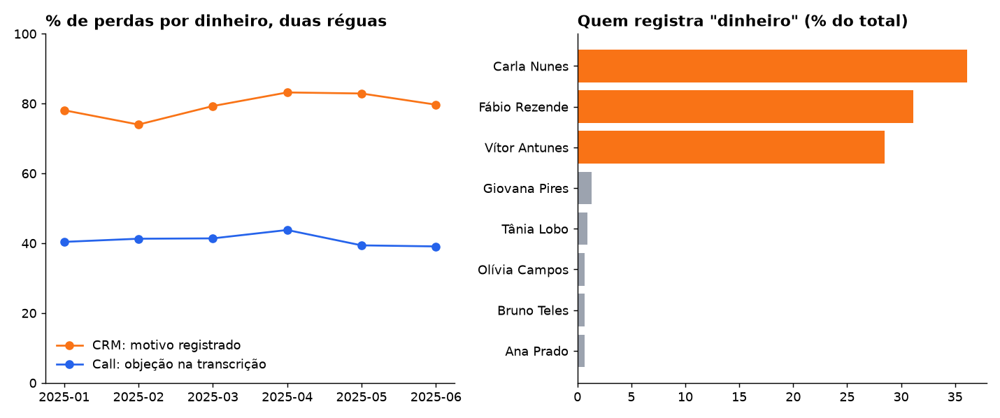

# 02 · "% de perda por dinheiro" mede quem registra, não a call

**Pergunta:** o CRM diz que ~80% das perdas depois da call são por dinheiro. Isso é verdade?

**Armadilha encontrada:** o motivo de perda é preenchido de forma desigual. Três vendedores preenchem 83–88% das suas perdas, e os outros cinco preenchem 4–6%. Esses três respondem por **95,7%** de todos os registros "dinheiro". O indicador mede o hábito de registro deles, não o que acontece nas calls.

## Método

1. Régua do CRM: perdas pós-call com motivo preenchido, % "dinheiro", por mês e por vendedor.
2. Régua da call: em cada call realizada sem venda, a flag de objeção de dinheiro extraída da transcrição. Ela conta todas as calls, sem depender de alguém registrar.
3. Conversão de quem levanta a objeção × quem não levanta.

## Resultado

| Mês | CRM: % dinheiro | Call: % com objeção de dinheiro | % das perdas com motivo preenchido |
|---|---:|---:|---:|
| 2025-01 | 78,1% | 40,4% | 23,7% |
| 2025-03 | 79,3% | 41,4% | 37,5% |
| 2025-06 | 79,7% | 39,1% | 33,8% |

- Pela transcrição, a objeção de dinheiro aparece em **~40%** das calls sem venda, estável o semestre todo. O CRM dobra esse número.
- O preenchimento sobe de 24% para 37% em março porque entra no time um vendedor que registra quase tudo. A composição do time move o indicador.
- A objeção pesa de verdade: quem a levanta converte 15,6%, contra 42,7% de quem não levanta. O problema não é a objeção existir, é o tamanho que o CRM dá a ela.

## Recomendação

- Para decisões sobre objeção (oferta, parcelamento, crédito), usar a régua da call.
- Se o motivo do CRM continuar sendo usado: tornar o campo obrigatório para todos e acompanhar a taxa de preenchimento ao lado do indicador.
- Contar por lead, não por call: calls longas podem gerar mais de um registro para a mesma pessoa.

Consultas: [`consulta.sql`](consulta.sql) · resultados em [`resultados/`](resultados/)
