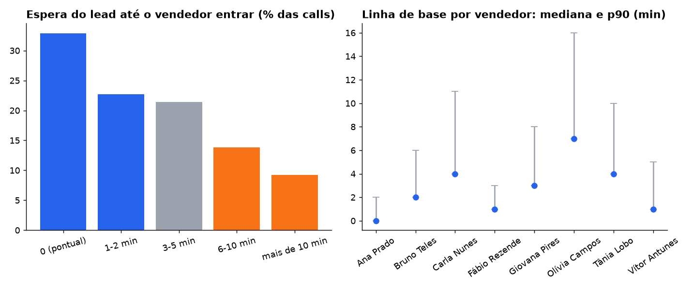

# 03 · Pontualidade das calls: quanto o lead espera o vendedor entrar

**Pergunta:** quanto tempo o lead fica sozinho na sala antes de o vendedor entrar?

**Armadilha encontrada:** cada vendedor reutiliza as mesmas salas de reunião em dias diferentes. Casar a agenda com o log de sessões **só pelo código da sala** puxa, em média, 233 sessões por agenda, e o "atraso" chega a 178 dias, para mais e para menos. Sem janela de tempo, qualquer média sai absurda.

## Método

1. Join agenda × log de sessões pelo código da sala **e** por uma janela de −30 a +120 minutos em torno do horário marcado. Dentro da janela, fica a sessão mais próxima do horário.
2. Espera = entrada do vendedor − max(horário marcado, entrada do lead), com piso em zero.
3. Só calls realizadas: lead presente e vendedor por pelo menos 20 minutos.
4. **Linha de base, não ranking:** vendedores em ordem alfabética, sem meta e sem "pior vendedor".

## Resultado

| Espera do lead | % das calls |
|---|---:|
| 0 (vendedor já na sala) | 32,9% |
| 1–2 min | 22,7% |
| 3–5 min | 21,4% |
| 6–10 min | 13,8% |
| mais de 10 min | 9,2% |

- Em seis meses, os leads somaram **238 horas** esperando, com média de 3,6 minutos por call.
- 23% das calls passam de 5 minutos de espera.
- A mediana por vendedor vai de 0 a 7 minutos. A dispersão é de comportamento individual, não de agenda lotada.

## Recomendação

- Publicar a linha de base e deixar a meta para a liderança comercial. Ranking punitivo antes de existir um combinado vira briga de dado.
- Lembrete automático 2 minutos antes do horário, que é barato e ataca justamente a cauda acima de 5 minutos.
- Qualquer métrica nova sobre esse log precisa reaproveitar o join com janela (view `calls` em [`../_base.sql`](../_base.sql)).

Consultas: [`consulta.sql`](consulta.sql) · resultados em [`resultados/`](resultados/)
