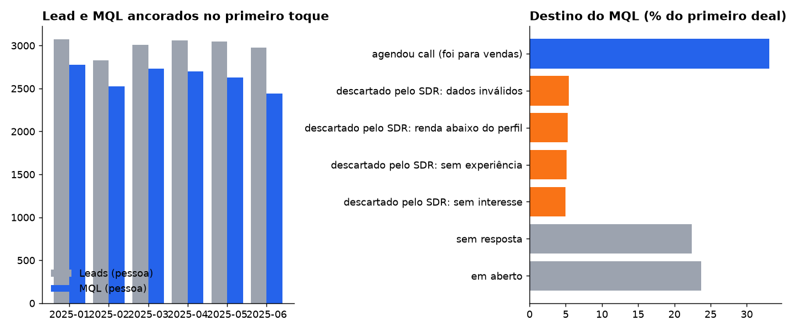

# 04 · Revisão da definição de MQL

**Pergunta:** o número de MQL está certo? E o que exatamente conta como MQL?

**Armadilhas encontradas**
- **Chave de contagem.** Contar deal (16.971), e-mail do contato (15.883) ou pessoa resolvida (15.800) dá três números diferentes para a mesma base. Pessoas com dois deals e deals sem e-mail no contato inflam a contagem.
- **Deal sem e-mail.** Em 618 deals o contato não tem e-mail, mas o e-mail está no nome do deal (`[Pós] Nome - email`). Sem extrair de lá, cada um vira uma pessoa a mais.
- **Âncora de data.** Lead e MQL datados por eventos diferentes (sessão do formulário × criação do deal) podem deixar o MQL do mês maior que o lead do mês. Ancorando os dois no **primeiro toque** (o menor entre formulário e CRM), MQL ≤ Lead vira garantia estrutural.

## Definição revisada

> **MQL = pessoa com pelo menos um deal no CRM, no mês do primeiro toque.**

## Resultado

| Destino do MQL | % |
|---|---:|
| Agendou call | 33,1% |
| Descartado pelo SDR (dados inválidos, renda, experiência, interesse) | 20,8% |
| Sem resposta | 22,4% |
| Em aberto | 23,7% |

- O bot de qualificação cria deal para toda faixa de renda menos "sem renda": 99% × 0%. Na prática, MQL é "não declarou renda zero".
- 1 em cada 5 MQLs é descartado pelo SDR na triagem. A régua pode ficar como está, mas o painel deveria mostrar o "MQL qualificado" ao lado.
- A queda de lead → MQL em junho (90% → 82%) vem do mix: aumentou a parcela "sem renda". Não é o SDR trabalhando pior.

## Recomendação

- Manter a definição e documentar a régua: chave, âncora e fonte.
- Exibir o MQL descartado separado, como número de apoio.
- Extrair o e-mail do nome do deal na camada de staging, não em cada consulta.

Consultas: [`consulta.sql`](consulta.sql) · resultados em [`resultados/`](resultados/)
