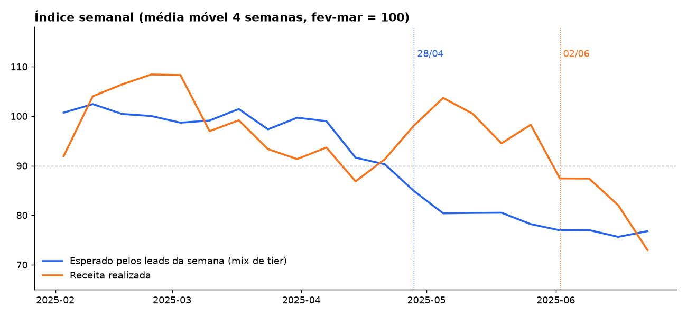

# 05 · Tiers de lead e previsibilidade de receita

**Pergunta:** dá para saber que a receita vai cair antes de ela cair?

**Armadilha encontrada:** a projeção usual é o run-rate linear (receita até hoje ÷ dias corridos × dias do mês). Ela só reage **depois** que a receita cai, porque trata todo lead como igual. O volume de leads ficou estável o semestre inteiro, e foi a composição que mudou.

## Método

1. **Tier** pela faixa de renda declarada no formulário: A (acima de 6k), B (3k–6k), C (até 3k), D (sem renda).
2. Conversão e ticket por tier, calibrados em jan–fev.
3. Indicador semanal: **receita esperada dos leads da semana** = Σ leads × conversão do tier × ticket do tier. Ele é conhecido no dia em que o lead chega.
4. Os dois índices em média móvel de 4 semanas, com base fev–mar = 100. Regra de alerta: abaixo de 90 por duas semanas seguidas.

## Resultado

| Tier | Conversão | Ticket médio |
|---|---:|---:|
| A | 12,97% | R$ 9.547 |
| B | 8,96% | R$ 9.323 |
| C | 1,79% | R$ 8.938 |
| D | 0,34% | — |

| Mês | Leads | % tier A |
|---|---:|---:|
| mar | 3.009 | 40,0% |
| abr | 3.061 | 30,2% |
| mai | 3.046 | 23,3% |

- O volume de leads não mudou. A parcela de tier A caiu de 40% para 23% a partir de meados de abril.
- O indicador de mix disparou o alerta em **28/04**. A receita realizada só caiu abaixo de 90 em **02/06**: **5 semanas de antecedência**.
- Em maio a receita ainda se segurou, com leads A de abril fechando e as vendas de um evento. É justamente o mês em que o run-rate dá falsa tranquilidade.

## Recomendação

- Acompanhar o indicador de mix semanal ao lado do run-rate no painel de pacing.
- Quando o alerta disparar, olhar a origem da mudança (campanha, criativo, público) antes de mexer na meta.
- Recalibrar conversão e ticket por tier a cada trimestre.

Consultas: [`consulta.sql`](consulta.sql) · resultados em [`resultados/`](resultados/) · índice e regra de alerta em [`../../run_all.py`](../../run_all.py) (`indice_semanal`, `semana_de_queda`)
