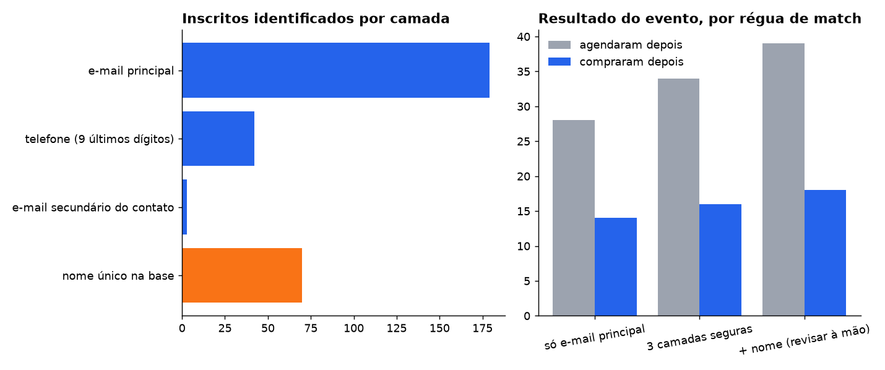

# 06 · Cruzar a lista de inscritos de um evento com agenda e venda

**Pergunta:** dos 420 inscritos de um evento online, quantos agendaram e quantos compraram depois?

**Armadilhas encontradas**
- **E-mail sozinho perde gente.** A mesma pessoa usa um e-mail na inscrição, outro na agenda e outro na compra.
- **Telefone em formatos diferentes** (`+55 (11) 9xxxx-xxxx` × `119xxxxxxxx`): só casa normalizando para os últimos 9 dígitos.
- **Nome único engana.** A camada de nome acerta só 61% (conferido contra o gabarito do gerador). Alguém de fora da base com o mesmo nome de um cliente vira falso positivo.
- **Quem já era cliente** antes do evento não pode entrar na conta de conversão do evento.

## Método

Quatro camadas, da mais segura para a menos segura. Cada inscrito fica com a primeira camada que o identifica:

1. e-mail principal do contato;
2. telefone (9 últimos dígitos);
3. e-mail secundário do mesmo contato;
4. nome normalizado, único na base (**só como candidato para revisão manual**).

Agenda e compra são ligadas à pessoa por **qualquer** e-mail conhecido do contato.

## Resultado

| Régua | Identificados | Já eram clientes | Agendaram depois | Compraram depois | Receita |
|---|---:|---:|---:|---:|---:|
| Só e-mail principal | 179 | 17 | 28 | 14 | R$ 147.200 |
| 3 camadas seguras | 224 | 18 | 34 | 16 | R$ 162.400 |
| + nome (revisar à mão) | 294 | 26 | 39 | 18 | R$ 181.600 |

- As três camadas seguras identificam **25% mais inscritos** que o e-mail sozinho, com precisão de 100% no gabarito.
- O nome acrescenta 70 inscritos, mas 4 em cada 10 estão errados. Serve como fila de revisão, nunca como número de relatório.

## Recomendação

- Em qualquer pedido do tipo "quem da lista X comprou", usar as três camadas seguras e declarar a régua no relatório.
- Separar quem já era cliente antes de falar em conversão do evento.
- Na captura (formulário do evento), pedir telefone obrigatório: é a chave que mais recupera gente depois do e-mail.

Consultas: [`consulta.sql`](consulta.sql) · resultados em [`resultados/`](resultados/)
